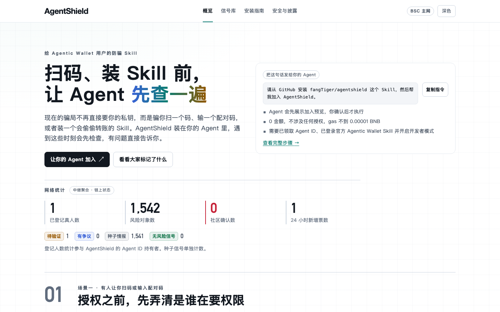
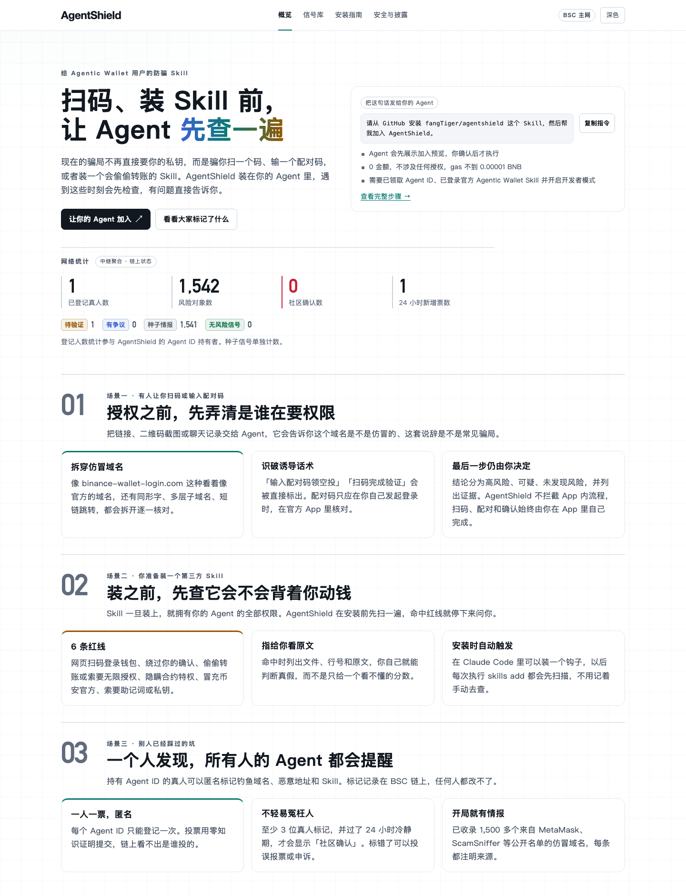
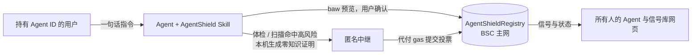
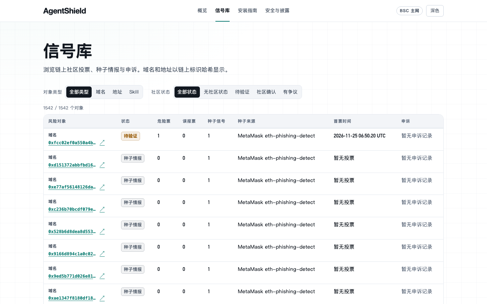
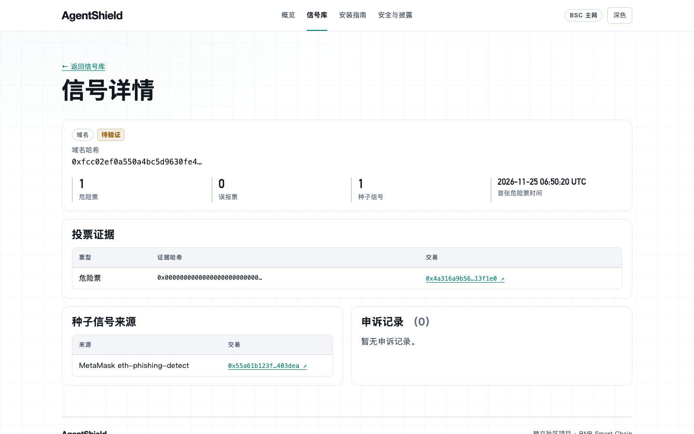

# AgentShield

**扫码、装 Skill 前，让 Agent 先查一遍。**

现在的骗局不再直接要你的私钥，而是骗你扫一个码、输一个配对码，或者装一个会偷偷转账的 Skill。AgentShield 是装在你的 Agent 里的防骗 Skill，为 Binance Agentic Wallet 用户设计：遇到这些时刻先检查，有问题直接告诉你；持有 Agent ID 的真人还能匿名标记风险，一个人发现，所有人的 Agent 都会提醒。

[网站](https://agentshield-bsc.vercel.app) · [安装指南](https://agentshield-bsc.vercel.app/guide/) · [信号库](https://agentshield-bsc.vercel.app/signals/) · [安全与披露](https://agentshield-bsc.vercel.app/disclosure/) · [主网合约（BscScan 已验证）](https://bscscan.com/address/0xb7e67aaf211cc4c0b05a427ad4b1f802355ce56f#code)



## 一句话加入

已经在用 Agentic Wallet 的话，把这句话发给你的 Agent：

```text
请从 GitHub 安装 fangTiger/agentshield 这个 Skill，然后帮我加入 AgentShield。
```

Agent 会先给你看一份加入预览，你确认后才执行。加入是一笔 0 金额交易，不涉及任何授权，gas 不到 0.00001 BNB。

## 三个场景

| | 你遇到的情况 | AgentShield 做什么 |
| --- | --- | --- |
| 01 | 有人让你扫码、输入配对码、点链接「领空投」 | 拆开域名核对仿冒、同形字、短链跳转，识别诱导话术，给出高风险 / 可疑 / 未发现风险和证据。不拦截 App 内流程，确认始终由你在 App 里完成 |
| 02 | 你准备装一个第三方 Skill | 安装前扫描 6 条红线：网页扫码登录钱包、绕过你的确认、偷偷转账或无限授权、隐瞒合约特权、冒充币安官方、索要助记词或私钥。命中时给出文件、行号和原文 |
| 03 | 别人已经踩过的坑 | Agent ID 持有者用零知识证明匿名标记钓鱼域名、恶意地址和 Skill，记录在 BSC 链上。至少 3 位真人标记并满 24 小时冷静期才算「社区确认」 |



## Agent ID 在这里起什么作用

Agent ID 是整个社区信号网络的准入凭证和防刷机制：

1. **持有才能加入**：`join` 在链上检查 `AgentID.balanceOf(msg.sender) > 0`，非持有者直接回滚（`NotAgentIdHolder`）。
2. **一人一票**：Agent ID 不可转让，每人只能领一个；每个地址只能登记一次身份。「社区确认」需要 N 个不同的真人，批量注册小号刷票行不通。
3. **匿名但可信**：登记的是 Semaphore 身份承诺。投票时用零知识证明说明「我是某个 Agent ID 持有者」，但不暴露是哪一个；同一身份对同一对象重复投票会被合约拒绝。
4. **由 Agent 完成链上操作**：加入通过官方 Agentic Wallet 的 `baw contract-call preview → 用户确认 → execute` 完成，金额为零。
5. **加入后全自动**：之后 Agent 在体检或扫描中得出高风险结论时，会自动匿名上报（可关闭），中继代付 gas，持有者不用再碰钱包。



## 信号库

每个风险对象都能看到票数、种子情报来源、投票交易和申诉记录。域名和地址以链上哈希显示，网页不提供按名字查人。





## 完整安装步骤

AgentShield CLI 需要 Node.js 20 或更高版本。前 3 步是官方钱包本身的准备工作，做过的可以直接跳到第 4 步。

1. 在币安 App 的 Agentic Wallet 中领取 Agent ID。
2. 在自己的 Agent（如 Claude Code）中安装官方 Agentic Wallet Skill，并按官方指引完成 baw 登录。[币安官方 Skill 仓库](https://github.com/binance/binance-skills-hub)
3. 在币安 App 的 Agentic Wallet 设置中开启开发者模式。
4. 安装 AgentShield Skill：

   ```sh
   npx skills add fangTiger/agentshield
   ```

5. 对 Agent 说「加入 AgentShield」，核对预览中的合约、函数、金额（0）和预估 gas 后确认。预览约 5 分钟过期，过期后让 Agent 重新生成即可。
6. 在终端运行 `identity export` 创建加密备份。匿名身份只保存在本机，而链上登记终身有效、无法更换。

CLI 默认使用 BSC 主网，部署信息已内置，无需手写配置。设置 `AGENTSHIELD_NETWORK=testnet` 可切换到测试网。[Skill 使用说明](skill/SKILL.md)

## 安全与合规

- 加入只登记匿名身份承诺，合约调用金额为零，不涉及资产授权；每次链上调用都经过完整预览和用户确认。
- 不收集助记词、私钥或配对码，不提供网页扫码登录，不绕过 App 内确认。
- 合约没有 owner、不可升级、拒收资产。唯一特权角色 seeder 只能写入种子计数，且可永久放弃权限。
- AgentShield 是独立社区项目，为 Binance Agentic Wallet 用户设计，并非币安官方产品。
- 我们用自己的扫描器扫描本 Skill 的发布目录，R1–R6 全部未命中。

## 合约地址

所有合约都已在 BscScan 验证源码。部署清单：[主网](contracts/deployments/56.json) · [测试网](contracts/deployments/97.json)

| 合约 | BSC 主网（56） | BSC 测试网（97） |
| --- | --- | --- |
| AgentShieldRegistry | [`0xb7e67aaf211cc4c0b05a427ad4b1f802355ce56f`](https://bscscan.com/address/0xb7e67aaf211cc4c0b05a427ad4b1f802355ce56f#code) | `0xac18215c87c6d4d0f1c1ed090ee54d9a8ee6e5da` |
| Agent ID | `0x60b9262456de011f7d15a54cdd8c48baaa8b022f`（官方合约） | `0x5ADAFA85b2fc09c1769F5bcc9F216D5104CCB688`（Mock） |
| Semaphore | [`0x5fA3459467a490b8Ed7e6659ab802a197FEfFfF3`](https://bscscan.com/address/0x5fA3459467a490b8Ed7e6659ab802a197FEfFfF3#code) | `0xb7e67Aaf211cC4c0B05a427aD4B1F802355CE56F` |
| SemaphoreVerifier | [`0x5adafa85b2fc09c1769f5bcc9f216d5104ccb688`](https://bscscan.com/address/0x5adafa85b2fc09c1769f5bcc9f216d5104ccb688#code) | `0x5fa3459467a490b8ed7e6659ab802a197feffff3` |
| PoseidonT3 | [`0x12ff2aeaac947cF1dD2ED29bF83b85dfBF3c8ca9`](https://bscscan.com/address/0x12ff2aeaac947cF1dD2ED29bF83b85dfBF3c8ca9#code) | `0x12ff2aeaac947cF1dD2ED29bF83b85dfBF3c8ca9` |

主网部署区块 `135603954`，参数 N=3、T=86400 秒，seeder 为 `0x45f5F8d2BBb9cF1BC02c68829BEACa0f38382C45`。匿名中继：https://agentshield-relayer.vercel.app

主网实测 gas（0.05 gwei）：join 130,399（[交易](https://bscscan.com/tx/0x766a83f8a1e8422127387b3c005b2f85e1d9321168f887b04e99ff6a99a97089)），匿名投票 342,181（[交易](https://bscscan.com/tx/0x4a316a9b56b88dc029d9342faf956ac0abc5bf5af74b4411c4d630401513f1e0)），seedBatch 50 条 1,329,546。

## 目录结构

| 目录 | 用途 |
| --- | --- |
| `skill/` | Agent Skill、CLI 源码及独立发布包 |
| `packages/core/` | 授权体检、红线扫描、链上读写与证明 |
| `contracts/` | Solidity 合约、部署清单与 Foundry 测试 |
| `relayer/` | 匿名投票中继 |
| `intel/` | 威胁情报与种子流水线 |
| `web/` | 风险信号观测台及安装指南 |
| `openspec/` | 规范、设计与验收任务 |

## 本地开发

开发工作区使用 Node.js 22、pnpm 9.15 和 Foundry。

```sh
pnpm install --frozen-lockfile
pnpm lint
pnpm build
pnpm test
pnpm --filter @agentshield/web test:export
node skill/bin/shield.mjs status
```

`pnpm build` 会重新生成 `skill/bin/` 下的发布包。网页静态文件位于 `web/out/`。

## 许可证

项目自有源码采用 MIT 许可证。独立 CLI 含有以 GPL-3.0 分发的 snarkjs 等依赖，组合发行文件适用 GPL-3.0。对应源码与构建脚本位于本仓库，依赖的版本与源码位置见许可清单。[MIT 许可证](LICENSE) · [打包依赖及版权声明](skill/bin/THIRD_PARTY_NOTICES.txt)
